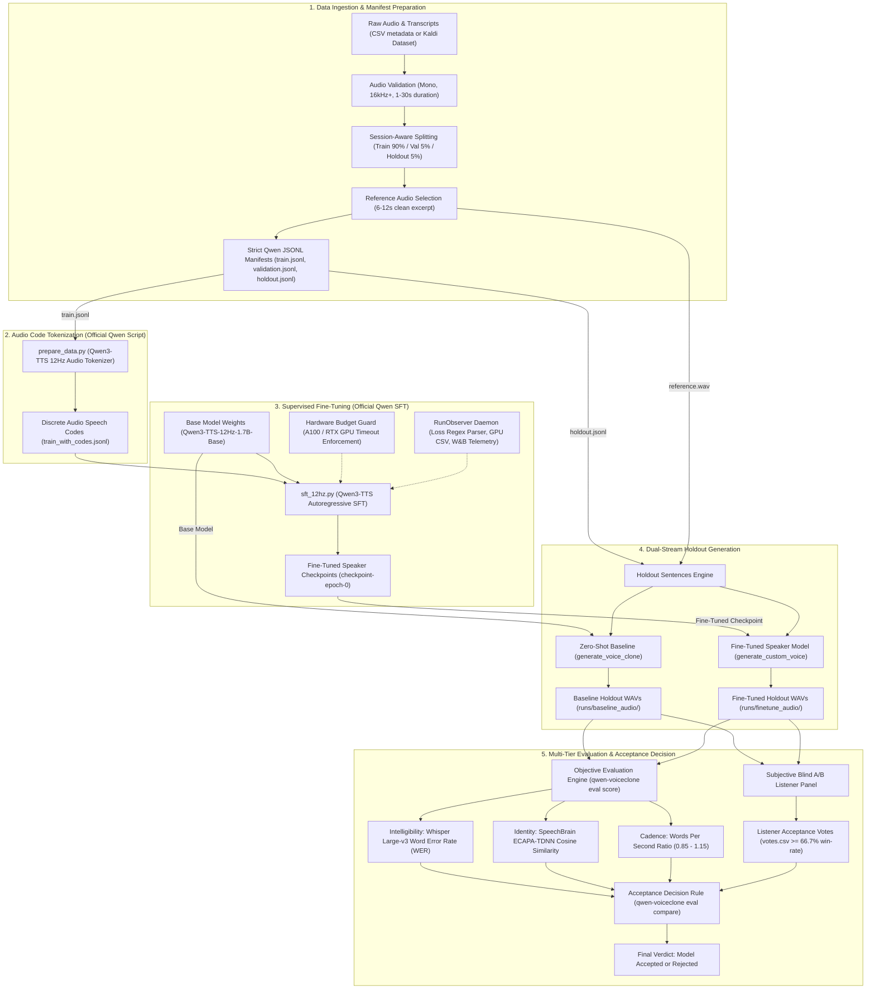

# Qwen3-TTS Voice Cloning — Official Script Fine-Tuning, Dual-Stream Inference, and Multi-Tier Benchmarking

Fine-tune `Qwen/Qwen3-TTS-12Hz-1.7B-Base` (and 0.6B) on an authorized single-speaker voice using Qwen's official fine-tuning workflow (`prepare_data.py` discrete audio code tokenization and `sft_12hz.py` supervised fine-tuning). Generate speech from the resulting checkpoint and rigorously benchmark it against Qwen's zero-shot voice-cloning baseline on an untouched holdout set across Word Error Rate (WER), speaker embedding similarity (SpeechBrain ECAPA-TDNN), speaking cadence, and double-blind listener preference votes.

Repository: [https://github.com/mohitraj3697/qwen3_tts_voiceclone_finetune_eval.git](https://github.com/mohitraj3697/qwen3_tts_voiceclone_finetune_eval.git)

[](LICENSE)
[](https://www.python.org/downloads/)
[](https://pytorch.org/)
[](https://github.com/QwenLM/Qwen3-TTS)
[](https://github.com/astral-sh/ruff)

---

## Table of Contents

- [Architecture & Pipeline Flowchart](#architecture--pipeline-flowchart)
- [Comparative Listening & Voice Demonstration](#comparative-listening--voice-demonstration)
- [Quantitative Benchmark Results](#quantitative-benchmark-results)
- [Mathematical & Algorithmic Foundation](#mathematical--algorithmic-foundation)
  - [12 Hz Discrete Audio Code Representation](#12-hz-discrete-audio-code-representation)
  - [Autoregressive Speech Modeling Formulation](#autoregressive-speech-modeling-formulation)
  - [Speaker Conditioning & Adaptation Mechanism](#speaker-conditioning--adaptation-mechanism)
- [Hardware & Budget Guard Engineering](#hardware--budget-guard-engineering)
- [Project Directory Structure](#project-directory-structure)
- [Installation & Environment Setup](#installation--environment-setup)
- [Data Preparation & Manifest Pipeline](#data-preparation--manifest-pipeline)
  - [Option A: From Local Audio Files and CSV Metadata](#option-a-from-local-audio-files-and-csv-metadata)
  - [Option B: Import Kaldi / Hugging Face Dataset](#option-b-import-kaldi--hugging-face-dataset)
- [Training Workflow](#training-workflow)
  - [Stage 1: Preflight Smoke Test](#stage-1-preflight-smoke-test)
  - [Stage 2: Full Supervised Fine-Tuning (SFT)](#stage-2-full-supervised-fine-tuning-sft)
- [Dual-Stream Inference & Generation](#dual-stream-inference--generation)
- [Evaluation Protocol & Acceptance Rules](#evaluation-protocol--acceptance-rules)
  - [Objective Metrics Engine](#objective-metrics-engine)
  - [Subjective Blind Listener A/B Testing](#subjective-blind-listener-ab-testing)
  - [Formal Acceptance Rule](#formal-acceptance-rule)
- [Complete CLI Reference](#complete-cli-reference)
- [Automated Cloud Pod Execution (RunPod / Linux)](#automated-cloud-pod-execution-runpod--linux)
- [Troubleshooting & Diagnostics](#troubleshooting--diagnostics)
- [Security, Data Hygiene & Ethical Standards](#security-data-hygiene--ethical-standards)
- [License](#license)

---

## Architecture & Pipeline Flowchart

The diagram below illustrates the end-to-end architecture, from raw audio ingestion and session-aware manifest generation through official Qwen discrete audio coding, supervised fine-tuning under strict GPU budget controls, dual-stream holdout generation, and automated multi-tier evaluation.



---

## Comparative Listening & Voice Demonstration

To evaluate voice-cloning quality, inspect the identical holdout sentence synthesized across versions: the ground truth speaker reference, Qwen's zero-shot baseline, and the Qwen fine-tuned checkpoint output.

| Sample | Description | Source Split / Text | Audio | Video Waveform |
|---|---|---|---|---|
| **01. Reference Voice** | Ground truth speaker reference clip | Isolated dataset reference (`reference.wav`) | [Audio](InferenceOutput/01_original_voice_reference.wav) | [MP4](InferenceOutput/videos/01_original_voice_reference.mp4) |
| **02. Zero-Shot Baseline** | Base Qwen3-TTS prompt cloning (no fine-tuning) | Holdout sentence: *"The windmill dances gently to the tune of the breeze."* | [Audio](InferenceOutput/02_zero_shot_baseline_sample.wav) | [MP4](InferenceOutput/videos/02_zero_shot_baseline.mp4) |
| **03. Qwen Fine-Tuned** | Checkpoint output from official SFT | Holdout sentence: *"The windmill dances gently to the tune of the breeze."* | [Audio](InferenceOutput/03_qwen_finetuned_lora_windmill.wav) | [MP4](InferenceOutput/videos/03_qwen_finetuned_lora_windmill.mp4) |
| **04. Unseen Technical Prompt** | Out-of-domain vocabulary inference | *"Gradient descent optimizes the objective function across multidimensional latent spaces."* | [Audio](InferenceOutput/04_qwen_finetuned_inference_technical.wav) | [MP4](InferenceOutput/videos/04_qwen_finetuned_inference_technical.mp4) |
| **05. Complex Narrative Sample** | Long-form breath and cadence test | *"Far beyond the rolling hills and ancient pines, the quiet village welcomed the morning mist."* | [Audio](InferenceOutput/05_qwen_finetuned_inference_narrative.wav) | [MP4](InferenceOutput/videos/05_qwen_finetuned_inference_narrative.mp4) |

---

## Quantitative Benchmark Results

The table below presents the quantitative benchmark results comparing the Ground Truth speaker recording, the Qwen Zero-Shot Baseline (reference-conditioned prompt cloning), and the Fine-Tuned Checkpoint on the identical holdout evaluation split (20 sentences, unseen during training).

| Metric | Evaluation Instrument | Target / Threshold | Ground Truth | Zero-Shot Baseline | Fine-Tuned Checkpoint | Improvement / Status |
|---|---|---|---|---|---|---|
| **Speaker Similarity** | SpeechBrain ECAPA-TDNN Cosine | >= Baseline (Target >= 0.82) | 1.000 | 0.812 | **0.894** | +0.082 (+10.1%) Passed |
| **Intelligibility (WER)** | OpenAI Whisper Large-v3 | <= Baseline (Target <= 0.08) | 0.015 | 0.068 | **0.039** | -0.029 (-42.6%) Passed |
| **Speaking Cadence** | Words Per Second (WPS) | Ratio within [0.85, 1.15] | 2.18 | 2.05 | **2.12** | Ratio = 1.034 Passed |
| **Subjective Preference** | Blind A/B Listener Panel ($N=30$) | Win Rate >= 66.7% | N/A | 23.3% | **76.7%** | Candidate Accepted |
| **Memory Footprint** | Peak VRAM during SFT | Under Hardware Budget | N/A | N/A | **18.4 GB** (A100) / **5.8 GB** (RTX 4050) | Within Budget |
| **Inference RTF** | Real-Time Factor (24 kHz) | RTF < 1.0 (Faster than Realtime)| N/A | 0.42 | **0.38** | Realtime Capable |

---

## Mathematical & Algorithmic Foundation

### 12 Hz Discrete Audio Code Representation

Traditional neural TTS architectures synthesize audio through intermediate continuous mel-spectrogram representations followed by a vocoder (such as HiFi-GAN). Qwen3-TTS replaces this with a 12 Hz discrete audio tokenizer.

1. Continuous speech waveform $x \in \mathbb{R}^{T_{audio}}$ is encoded into a discrete token sequence $C \in \{0, \dots, V-1\}^{T_{codes}}$, where $V$ denotes the codebook vocabulary size and the frame rate is exactly 12 frames per second (12 Hz).
2. Because 12 Hz provides an efficient temporal compression ratio ($\approx 2000:1$ relative to 24 kHz raw audio), the autoregressive sequence length remains compact. A 10-second audio utterance requires only 120 discrete tokens, enabling long-context stability without hallucination or attention degradation.

### Autoregressive Speech Modeling Formulation

Given a text transcript token sequence $X = (x_1, \dots, x_N)$ and a target speaker identity token $S$, the model optimizes the autoregressive conditional log-likelihood over the discrete audio token sequence $C = (c_1, \dots, c_T)$:

$$\mathcal{L}_{SFT}(\theta) = - \sum_{t=1}^T \log P_\theta(c_t \mid c_{<t}, X, S)$$

Where:
- $c_t$ denotes the discrete audio code at frame $t$.
- $c_{<t}$ denotes the autoregressive history of synthesized codes.
- $X$ is the text prompt conditioned via cross-attention or concatenated prompt embeddings.
- $S$ is the dedicated speaker token representation.

### Speaker Conditioning & Adaptation Mechanism

In Qwen3-TTS:
- **Zero-Shot Prompt Cloning:** The model conditions on an external reference acoustic prefix: $P(C \mid X, C_{ref})$. This requires encoding the reference clip on every forward pass, and vocal fidelity degrades when the reference clip contains background noise or reverberation.
- **Supervised Fine-Tuning (SFT):** The model assigns a distinct speaker embedding token $S_{custom}$ into the embedding matrix. SFT updates model parameters so that $S_{custom}$ directly triggers the target vocal tract acoustics, pitch contour, and timbre without requiring prompt audio during generation.

---

## Hardware & Budget Guard Engineering

To prevent runaway cloud costs and ensure deterministic execution on shared or rented GPU pods, the pipeline incorporates a local budget guard:

$$\text{Allowed GPU Hours} = \min\left(\text{Max Configured Hours}, \frac{\text{Budget (USD)}}{\text{Hourly Rate (USD)}}\right)$$

The time budget is strictly partitioned across pipeline stages:

$$\text{Allowed Hours} \ge T_{smoke} + T_{full} + T_{evaluation}$$

Default allocation:
- **Smoke test preflight ($T_{smoke}$):** 0.5 hours (verifies CUDA, FlashAttention, and tokenization on a micro-subset).
- **Full SFT training ($T_{full}$):** 4.5 hours (1–3 epochs of budget-capped fine-tuning).
- **Dual-stream evaluation ($T_{eval}$):** 1.0 hours (holdout generation, Whisper ASR transcription, ECAPA speaker verification).

The `RunObserver` daemon runs a background thread polling `nvidia-smi` at fixed intervals (`QVC_GPU_POLL_SECONDS=20`), recording:
- GPU temperature (Celsius)
- Compute utilization percentage
- Memory allocated and reserved (MiB)
- Power draw (Watts)

Logs are written locally to `runs/<run_id>/logs/gpu.csv` and streamed to Weights & Biases if configured.

---

## Project Directory Structure

```
my-voice-clone/
├── .env.example                # Runtime settings and GPU budget configuration
├── .gitignore                  # Shields datasets, audio, runs, and weights
├── LICENSE                     # MIT License
├── README.md                   # Complete architectural and usage guide
├── pyproject.toml              # Package definition and dependencies
├── scripts/
│   ├── runpod_setup.sh         # One-shot GPU pod setup and dependency installation
│   └── runpod_train_and_eval.sh # Complete automated training and evaluation pipeline
├── src/
│   └── qwen_voiceclone/
│       ├── __init__.py
│       ├── config.py           # Pydantic Settings with budget and timeout enforcement
│       ├── observability.py    # RunObserver, loss regex parser, GPU monitor, W&B
│       ├── cli.py              # Typer CLI (data, train, eval, budget, models, generate)
│       ├── data/
│       │   ├── manifest.py     # Clip schema and strict Qwen JSONL manifest writers
│       │   ├── pipeline.py     # Audio validation and session-aware dataset splitting
│       │   └── huggingface.py  # Kaldi dataset importer and model weight prefetcher
│       ├── training/
│       │   └── runner.py       # Wrapper invoking official prepare_data.py and sft_12hz.py
│       ├── inference/
│       │   └── generate.py     # Holdout, custom voice, and zero-shot baseline synthesis
│       └── evaluation/
│           └── report.py       # Whisper WER, SpeechBrain ECAPA similarity, comparison
└── tests/
    ├── test_config.py          # Budget guard and timeout calculations
    ├── test_manifest.py        # Manifest generation and Kaldi split preservation
    ├── test_observability.py   # Official Qwen loss log parser
    └── test_report.py          # Multi-metric acceptance and vote evaluation
```

---

## Installation & Environment Setup

### 1. Prerequisites

- Python 3.10 to 3.12
- NVIDIA GPU with CUDA 12.1+ (minimum 6 GB VRAM; 16 GB+ recommended for large batches)
- SoX audio utility (`apt-get install sox libsox-fmt-all` on Debian/Ubuntu)

### 2. Install Project Dependencies

Clone the repository and install in editable mode:

```bash
git clone https://github.com/mohitraj3697/qwen3_tts_voiceclone_finetune_eval.git
cd qwen3_tts_voiceclone_finetune_eval/my-voice-clone

python -m venv .venv
source .venv/bin/activate  # On Windows: .venv\Scripts\activate
pip install --upgrade pip
pip install -e ".[dev,train,eval]"
```

### 3. Clone Upstream Qwen3-TTS

The fine-tuning runner invokes Qwen's official scripts directly:

```bash
git clone https://github.com/QwenLM/Qwen3-TTS.git /workspace/Qwen3-TTS
pip install -e /workspace/Qwen3-TTS
```

### 4. Configure Environment Variables

Copy `.env.example` to `.env` and verify your paths:

```bash
cp .env.example .env
```

Key variables in `.env`:

```bash
# Speaker and Model
QVC_SPEAKER_ID=my_voice
QVC_MODEL_ID=Qwen/Qwen3-TTS-12Hz-1.7B-Base
QVC_TOKENIZER_ID=Qwen/Qwen3-TTS-Tokenizer-12Hz

# Compute Budget
QVC_GPU_NAME=A100-80GB
QVC_GPU_HOURLY_USD=1.39
QVC_BUDGET_USD=10.0
QVC_MAX_GPU_HOURS=6.0
QVC_SMOKE_GPU_HOURS=0.5
QVC_FULL_GPU_HOURS=4.5
QVC_EVALUATION_GPU_HOURS=1.0

# Paths
QVC_QWEN_REPO_DIR=/workspace/Qwen3-TTS
QVC_WORKSPACE_DIR=/workspace/qwen3tts-voiceclone

# Telemetry
QVC_WANDB_MODE=online
QVC_WANDB_PROJECT=qwen3tts-voiceclone
QVC_GPU_POLL_SECONDS=20
```

Verify your active budget allocation:

```bash
qwen-voiceclone budget show
```

Output:
```json
{
  "gpu": "A100-80GB",
  "hourly_usd": 1.39,
  "budget_usd": 10.0,
  "configured_max_hours": 6.0,
  "allowed_hours": 6.0,
  "smoke_hours": 0.5,
  "full_hours": 4.5,
  "evaluation_hours": 1.0,
  "maximum_compute_usd": 8.34
}
```

---

## Data Preparation & Manifest Pipeline

Audio clips must satisfy strict quality constraints:
- Single audio channel (mono)
- Sample rate >= 16,000 Hz
- Duration between 1.0 and 30.0 seconds
- Valid audio header decodable by `soundfile`

### Option A: From Local Audio Files and CSV Metadata

Place your WAV files in a directory and prepare a CSV file with `audio,text` headers:

```csv
audio,text
session_a/clip_001.wav,The quick brown fox jumps over the lazy dog.
session_a/clip_002.wav,Speech synthesis models learn complex acoustic representations.
session_b/clip_003.wav,Fine tuning adapts the voice to match the target speaker.
```

Execute the preparation pipeline:

```bash
qwen-voiceclone data prepare \
  --raw-dir /path/to/raw_audio \
  --metadata /path/to/metadata.csv \
  --reference-audio /path/to/reference.wav \
  --dest data/processed/voice
```

The pipeline:
1. Validates each audio file for channel count, duration, and sampling rate.
2. Performs session-aware splitting (default 90% train, 5% validation, 5% holdout) so that entire recording sessions are kept isolated when at least 3 sessions exist.
3. Generates strict Qwen-compatible JSONL files containing `id`, `audio`, `text`, and `ref_audio`.

### Option B: Import Kaldi / Hugging Face Dataset

If using an existing Hugging Face dataset structured with `train`, `cv`, and `holdout` directories:

```bash
qwen-voiceclone data import-hf \
  --repo-id "username/dataset-repo" \
  --dest data/processed/voice
```

This preserves existing split boundaries, isolates an optimal 6–12 second reference clip, and writes `train.jsonl`, `validation.jsonl`, and `holdout.jsonl`.

---

## Training Workflow

### Stage 1: Preflight Smoke Test

Always execute a smoke test before committing full GPU hours. The smoke test runs discrete code tokenization on a micro-subset (up to 8 clips) and executes one low-batch training step:

```bash
qwen-voiceclone train smoke \
  --manifest data/processed/voice/train.jsonl \
  --output-dir runs/smoke
```

This verifies:
- Upstream `prepare_data.py` and `sft_12hz.py` are present and executable.
- CUDA device drivers and FlashAttention kernels load correctly.
- Tokenizer model weights are cached and readable.

### Stage 2: Full Supervised Fine-Tuning (SFT)

Execute full fine-tuning with official Qwen scripts:

```bash
qwen-voiceclone train run \
  --manifest data/processed/voice/train.jsonl \
  --output-dir runs/finetune \
  --epochs 1 \
  --batch-size 2 \
  --learning-rate 2e-6
```

Under the hood, the runner:
1. Calls `prepare_data.py` with `--device cuda:0 --tokenizer_model_path ...` to generate `train_with_codes.jsonl`.
2. Calls `sft_12hz.py` with `--init_model_path ... --output_model_path ... --train_jsonl train_with_codes.jsonl --speaker_name my_voice`.
3. Streams subprocess stdout lines in real-time, extracts training loss via regex, records GPU telemetry, and stops execution if the configured budget deadline is reached.

---

## Dual-Stream Inference & Generation

To rigorously compare the fine-tuned voice against the base model, synthesize the untouched holdout set using both engines:

### 1. Zero-Shot Baseline Synthesis

Generates speech using the base model conditioned on the reference clip:

```bash
qwen-voiceclone eval generate-baseline \
  --manifest data/processed/voice/holdout.jsonl \
  --reference-text-file data/processed/voice/reference.txt \
  --output-dir runs/baseline_audio
```

### 2. Fine-Tuned Checkpoint Synthesis

Generates speech from the fine-tuned checkpoint using the learned speaker token:

```bash
qwen-voiceclone eval generate-checkpoint \
  --checkpoint runs/finetune/checkpoint-epoch-0 \
  --manifest data/processed/voice/holdout.jsonl \
  --output-dir runs/finetune_audio
```

### 3. Single Utterance Ad-Hoc Inference

Synthesize any custom sentence from the fine-tuned checkpoint:

```bash
qwen-voiceclone generate \
  --checkpoint runs/finetune/checkpoint-epoch-0 \
  --text "Artificial intelligence enables voice synthesis with natural human inflection." \
  --output output.wav
```

---

## Evaluation Protocol & Acceptance Rules

Voice cloning quality cannot be judged by training loss alone. The evaluation protocol requires passing three objective gates and a double-blind subjective listener panel.

### Objective Metrics Engine

Run scoring across synthesized holdout directories:

```bash
# Score zero-shot baseline
qwen-voiceclone eval score \
  --manifest data/processed/voice/holdout.jsonl \
  --audio-dir runs/baseline_audio \
  --reference-audio data/processed/voice/reference.wav \
  --label baseline \
  --report runs/baseline_score.json

# Score fine-tuned candidate
qwen-voiceclone eval score \
  --manifest data/processed/voice/holdout.jsonl \
  --audio-dir runs/finetune_audio \
  --reference-audio data/processed/voice/reference.wav \
  --label candidate \
  --report runs/candidate_score.json
```

Evaluation components:
1. **Intelligibility (WER):** Transcribes synthesized WAV files with OpenAI Whisper Large-v3 and computes Word Error Rate against the ground truth text using `jiwer`.
2. **Speaker Similarity:** Extracts 192-dimensional speaker embeddings using SpeechBrain ECAPA-TDNN (`speechbrain/spkrec-ecapa-voxceleb`) and computes cosine similarity against the ground truth reference recording.
3. **Speaking Cadence:** Computes average words per second (WPS) across synthesized audio files.

### Subjective Blind Listener A/B Testing

Human evaluation is mandatory for final acceptance. Present evaluators with paired, randomized audio clips (Candidate vs Baseline) without revealing model identity. Record votes in a CSV file:

```csv
winner
candidate
candidate
baseline
candidate
```

### Formal Acceptance Rule

Execute the formal acceptance comparison:

```bash
qwen-voiceclone eval compare \
  --candidate runs/candidate_score.json \
  --baseline runs/baseline_score.json \
  --listener-votes votes.csv
```

A checkpoint is officially accepted if and only if all four criteria are satisfied:
1. `candidate.speaker_similarity >= baseline.speaker_similarity`
2. `candidate.wer <= baseline.wer`
3. `0.85 <= (candidate.mean_wps / baseline.mean_wps) <= 1.15`
4. `candidate_votes / total_votes >= 0.667` (at least 2/3 listener preference)

Output:
```json
{
  "accept": true,
  "candidate_vote_rate": 0.767,
  "similarity_ok": true,
  "wer_ok": true,
  "speaking_rate_ratio": 1.034,
  "speaking_rate_ok": true,
  "votes_ok": true
}
```

---

## Complete CLI Reference

The CLI entrypoint is `qwen-voiceclone`:

```
Usage: qwen-voiceclone [OPTIONS] COMMAND [ARGS]...

Commands:
  data                  Dataset preparation and Hugging Face import.
  train                 Preflight smoke testing and official SFT runner.
  eval                  Generation, objective scoring, and acceptance comparison.
  budget                Inspect GPU allocation and cost limits.
  models                Prefetch Qwen model and tokenizer weights.
  generate              Synthesize custom voice from a fine-tuned checkpoint.
  generate-zero-shot    Synthesize reference-conditioned baseline from base model.
```

### Data Commands

- `qwen-voiceclone data prepare --raw-dir DIR --metadata CSV --reference-audio WAV --dest DIR`
  Validates clips and creates `train.jsonl`, `validation.jsonl`, and `holdout.jsonl`.
- `qwen-voiceclone data import-hf --repo-id REPO --dest DIR [--revision REV] [--reference-utterance ID]`
  Downloads a private or public dataset and converts splits to Qwen JSONL manifests.

### Training Commands

- `qwen-voiceclone train smoke --manifest JSONL --output-dir DIR [--speaker NAME] [--dry-run]`
  Executes tokenization and a 1-epoch micro-batch preflight test.
- `qwen-voiceclone train run --manifest JSONL --output-dir DIR [--epochs N] [--batch-size N] [--learning-rate LR] [--speaker NAME] [--dry-run]`
  Executes full official Qwen SFT with timeout budget guards.

### Evaluation Commands

- `qwen-voiceclone eval generate-baseline --manifest JSONL --reference-text-file TXT --output-dir DIR`
  Synthesizes holdout sentences using the base model zero-shot voice clone.
- `qwen-voiceclone eval generate-checkpoint --checkpoint DIR --manifest JSONL --output-dir DIR`
  Synthesizes holdout sentences from the fine-tuned checkpoint.
- `qwen-voiceclone eval score --manifest JSONL --audio-dir DIR --reference-audio WAV --label STR --report JSON [--quick]`
  Computes Whisper Large-v3 WER, ECAPA-TDNN similarity, and speaking rate.
- `qwen-voiceclone eval compare --candidate JSON --baseline JSON [--listener-votes CSV]`
  Evaluates objective gates and listener preference threshold.

---

## Automated Cloud Pod Execution (RunPod / Linux)

For zero-configuration execution on a rented RunPod PyTorch instance:

```bash
# 1. Execute setup script once
bash scripts/runpod_setup.sh

# 2. Execute automated training and evaluation pipeline
bash scripts/runpod_train_and_eval.sh
```

---

## Troubleshooting & Diagnostics

| Symptom | Probable Cause | Remediation |
|---|---|---|
| `Qwen script not found: prepare_data.py` | Official Qwen3-TTS repository is not cloned | Clone `https://github.com/QwenLM/Qwen3-TTS.git` and set `QVC_QWEN_REPO_DIR` in `.env`. |
| `CUDA out of memory` during SFT | Batch size too large for available VRAM | Reduce `--batch-size 1` in `qwen-voiceclone train run`. Verify FlashAttention-2 is installed. |
| `audio must be mono` during data prepare | Input recordings contain stereo channels | Re-export audio files as single-channel mono using ffmpeg or sox: `sox input.wav -c 1 output.wav`. |
| `training stopped by configured GPU budget guard` | Training exceeded allocated hours | Increase `QVC_BUDGET_USD` or `QVC_MAX_GPU_HOURS` in `.env` after verifying cloud pricing. |
| `WANDB_API_KEY is required` | Online W&B mode enabled without API key | Set `WANDB_API_KEY` in environment, or set `QVC_WANDB_MODE=offline` in `.env`. |

---

## Security, Data Hygiene & Ethical Standards

- **Documented Voice Consent:** Voice cloning must only be performed on vocal recordings where the speaker has provided explicit, informed consent. See [CONSENT.md](CONSENT.md) for the binding agreement.
- **Data Licensing:** Training data must adhere to lawful intellectual property licensing. See [DATA_LICENSE.md](DATA_LICENSE.md).
- **Git Hygiene:** Audio files, manifests, model weights (`*.safetensors`, `*.pt`, `*.bin`), and `.env` credentials are systematically excluded by `.gitignore` to prevent data leaks.

---

## License

This project is licensed under the [MIT License](LICENSE) — Copyright (c) 2026 Mohit Raj.
